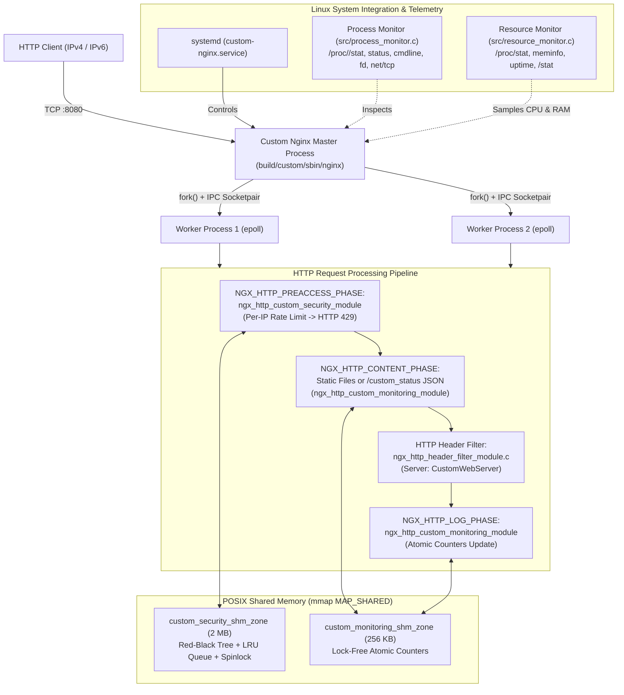

# Custom Nginx Web Server with Security, Monitoring & Linux System Integration on Ubuntu

## 1. Introduction (Giới thiệu)
Dự án **Custom Nginx Web Server on Ubuntu** là đồ án học phần *Linux và Phần mềm mã nguồn mở*, thực hiện tải về mã nguồn chính thức của **Nginx Open Source (`1.26.2`)**, phân tích kiến trúc hướng sự kiện đa tiến trình, tùy biến trực tiếp mã nguồn C của Nginx, phát triển hai module HTTP bằng ngôn ngữ C (**Custom Security Module** và **Custom Monitoring Module**), xây dựng hệ thống tự động hóa biên dịch với **GCC & GNU Make**, tích hợp dịch vụ **systemd**, và phát triển bộ công cụ giám sát tiến trình & tài nguyên **Linux `/proc` (`procfs`)** bằng C.

---

## 2. Objectives (Mục tiêu Dự án)
1. Tải về, xác thực chữ ký số PGP / mã băm SHA-256 và phân tích cấu trúc mã nguồn C của Nginx (`src/core`, `src/event`, `src/http`, `src/os/unix`, `auto`).
2. Tùy biến trực tiếp mã nguồn C của Nginx để thay thế `Server` header thành `CustomWebServer` và loại bỏ hoàn toàn việc rò rỉ phiên bản máy chủ trên mọi phản hồi HTTP và trang lỗi.
3. Phát triển module bảo mật C (`ngx_http_custom_security_module`) thực hiện giới hạn tần suất truy cập (Rate Limiting) theo địa chỉ IP thực (IPv4/IPv6) xuyên suốt nhiều tiến trình Worker qua vùng nhớ chia sẻ (`ngx_shm_zone_t`, Red-Black Tree + LRU Queue), trả về `HTTP 429` và ghi log sự kiện bảo mật.
4. Phát triển module giám sát C (`ngx_http_custom_monitoring_module`) thu thập số liệu thời gian thực bằng phép toán nguyên tử (`ngx_atomic_fetch_add`) và xuất báo cáo JSON tại `/custom_status` kèm cơ chế kiểm soát truy cập theo IP/CIDR.
5. Tự động hóa quy trình tải nguồn, vá lỗi (patch), cấu hình, biên dịch, cài đặt vào prefix cô lập (`build/custom/`) và kiểm증 bằng Bash & GNU Make.
6. Tích hợp với **Linux systemd** (`systemd/custom-nginx.service`), quản lý tín hiệu POSIX (`SIGHUP`, `SIGUSR1`, `SIGUSR2`, `SIGQUIT`, `SIGTERM`), và phát triển hai công cụ C đọc trực tiếp hệ thống tệp ảo `/proc`:
   - `build/bin/process_monitor` ([src/process_monitor.c](file:///home/truongphuoc/Desktop/custom-nginx-project/src/process_monitor.c))
   - `build/bin/resource_monitor` ([src/resource_monitor.c](file:///home/truongphuoc/Desktop/custom-nginx-project/src/resource_monitor.c))
7. Kiểm thử tích hợp toàn diện (`tests/run_all_tests.sh`) và đánh giá hiệu năng (**Benchmark**) giữa Original Nginx và Custom Nginx.

---

## 3. Technologies (Công nghệ Sử dụng)
- **Hệ điều hành**: Ubuntu Linux 20.04.4 LTS (`Kernel 5.15.0-139-generic x86_64`)
- **Ngôn ngữ lập trình**: C (ISO C99/C11, POSIX.1-2008, Linux System Calls) & Bash (`set -euo pipefail`)
- **Trình biên dịch & Build**: `GCC 9.4.0` (`-Wall -Wextra -Wpedantic -Werror -O2`), `GNU Make 4.2.1`
- **Kiến trúc Web Server**: Nginx Open Source `1.26.2` HTTP Module API (`ngx_http_module_t`, `ngx_shm_zone_t`, `ngx_slab_pool_t`, `ngx_rbtree_t`, `ngx_atomic_t`)
- **Giao diện Hệ thống Linux**: `/proc` filesystem (`procfs`), POSIX Signals (`sigaction`, `sigsuspend`), `epoll`, TCP/IP sockets (`AF_INET`, `AF_INET6`), `systemd`

---

## 4. Architecture (Kiến trúc Hệ thống)


---

## 5. Directory Structure (Cấu trúc Thư mục)
```text
custom-nginx-project/
├── build/
│   ├── bin/
│   │   ├── process_monitor             # Công cụ C giám sát tiến trình Nginx qua /proc
│   │   ├── resource_monitor            # Công cụ C giám sát CPU/RAM Nginx qua /proc
│   │   └── ab                          # Công cụ C epoll HTTP Benchmark tương thích ApacheBench
│   ├── original/sbin/nginx             # Binary Nginx 1.26.2 nguyên bản (dùng để đối조 Benchmark)
│   └── custom/sbin/nginx               # Binary Custom Nginx đã vá mã nguồn & tích hợp 2 module C
├── config/
│   ├── nginx.conf                      # Cấu hình runtime chính của Custom Nginx (Port 8080)
│   └── mime.types                      # Bảng ánh xạ kiểu MIME
├── docs/
│   ├── ARCHITECTURE.md                 # Tài liệu kiến trúc tổng thể
│   ├── nginx_source_analysis.md        # Phân tích mã nguồn Nginx 1.26.2
│   ├── nginx_module_architecture.md    # Kiến trúc Module và HTTP Phase Pipeline
│   ├── custom_server_header.md         # Tài liệu tùy biến Server Header
│   ├── custom_security_module.md       # Tài liệu thiết kế Custom Security Module
│   ├── custom_monitoring_module.md     # Tài liệu thiết kế Custom Monitoring Module
│   ├── build_pipeline.md               # Tài liệu hệ thống Build tự động
│   ├── systemd_integration.md          # Tài liệu tích hợp systemd
│   ├── linux_process_monitoring.md     # Tài liệu giám sát tiến trình qua /proc
│   ├── linux_signal_handling.md        # Tài liệu xử lý tín hiệu POSIX
│   ├── linux_resource_monitoring.md    # Tài liệu giám sát tài nguyên CPU/RAM
│   ├── benchmark_report.md             # Báo cáo Benchmark Original vs Custom Nginx
│   └── final_report.md                 # Báo cáo tổng kết đồ án (12 chương)
├── include/
│   ├── process_monitor.h               # Header cho Process Monitor
│   └── resource_monitor.h              # Header cho Resource Monitor
├── logs/
│   ├── access.log                      # Nhật ký truy cập HTTP (kèm pid Worker)
│   ├── error.log                       # Nhật ký lỗi và cảnh báo hệ thống
│   ├── security.log                    # Nhật ký sự kiện bảo mật trích xuất từ error.log
│   ├── build.log                       # Nhật ký toàn bộ quá trình biên dịch tự động
│   └── benchmark_raw.log               # Kết quả đo kiểm hiệu năng thực tế
├── modules/
│   ├── security/
│   │   ├── config                      # Tệp cấu hình tích hợp module bảo mật vào auto/configure
│   │   └── ngx_http_custom_security_module.c
│   └── monitoring/
│       ├── config                      # Tệp cấu hình tích hợp module giám sát vào auto/configure
│       └── ngx_http_custom_monitoring_module.c
├── patches/
│   └── custom_server_header.patch      # Bản vá Unified Diff thay đổi Server Header
├── scripts/
│   ├── check_environment.sh            # Kiểm tra môi trường Ubuntu, GCC, Make, Dependencies
│   ├── download_nginx.sh               # Tải và xác thực SHA-256 nguồn Nginx 1.26.2
│   ├── apply_patches.sh                # Áp dụng bản vá C idempotent (chống lặp)
│   ├── configure_nginx.sh              # Chạy ./configure với prefix cô lập & custom modules
│   ├── build_nginx.sh                  # Biên dịch đa luồng với GCC & GNU Make
│   ├── install_nginx.sh                # Cài đặt vào build/custom/
│   ├── clean_build.sh                  # Dọn dẹp cổ vật build và khôi phục cây nguồn sạch
│   ├── build_all.sh                    # Pipeline tự động hóa 13 bước từ đầu đến cuối
│   ├── service_start.sh                # Khởi chạy dịch vụ qua systemd an toàn
│   ├── service_stop.sh                 # Dừng dịch vụ qua systemd an toàn
│   ├── service_reload.sh               # Kiểm tra nginx -t và reload không gián đoạn
│   ├── service_status.sh               # Hiển thị trạng thái systemd, cổng, PID và log
│   ├── test_signal_handling.sh         # Kiểm thử tự động các tín hiệu Linux
│   └── run_benchmark.sh                # Chạy Benchmark đối chiếu Original vs Custom Nginx
├── source/
│   ├── nginx-1.26.2.tar.gz             # Gói mã nguồn chính thức từ nginx.org
│   ├── nginx-1.26.2.tar.gz.asc         # Chữ ký số PGP chính thức
│   ├── nginx-original/                 # Cây mã nguồn nguyên bản dùng để đối chiếu diff
│   └── nginx/                          # Cây mã nguồn làm việc và biên dịch
├── src/
│   ├── process_monitor.c               # Mã nguồn C công cụ giám sát tiến trình
│   ├── resource_monitor.c              # Mã nguồn C công cụ giám sát CPU/RAM
│   └── ab_bench.c                      # Mã nguồn C công cụ Benchmark HTTP epoll
├── systemd/
│   └── custom-nginx.service            # Unit file systemd cho Custom Nginx
├── tests/
│   ├── test_security.sh                # Bộ kiểm thử Custom Security Module
│   ├── test_monitoring.sh              # Bộ kiểm thử Custom Monitoring Module
│   ├── test_process_monitor.sh         # Bộ kiểm thử Process Monitor
│   ├── test_resource_monitor.sh        # Bộ kiểm thử Resource Monitor
│   └── run_all_tests.sh                # Script tổng hợp chạy toàn bộ 10 bộ kiểm thử
├── web/
│   └── index.html                      # Giao diện trang chủ Custom Nginx Web Server
└── Makefile                            # Makefile điều phối toàn bộ vòng đời dự án
```

---

## 6. Installation & Environment Check (Kiểm tra Môi trường)
Kiểm tra hệ điều hành Ubuntu, phiên bản nhân Linux, GCC, GNU Make và các gói phụ thuộc:
```bash
./scripts/check_environment.sh
# Hoặc thông qua Makefile:
make check
```
Nếu máy chủ thiếu các gói tùy chọn (`libpcre2-dev`, `zlib1g-dev`, `libssl-dev`, `apache2-utils`), script sẽ in ra câu lệnh gợi ý:
```bash
sudo apt-get update && sudo apt-get install -y libpcre2-dev zlib1g-dev libssl-dev apache2-utils
```
*(Hệ thống cấu hình `scripts/configure_nginx.sh` tự động phát hiện thư viện hiện có để biên dịch thành công mà không bắt buộc quyền `sudo`).*

---

## 7. Download Source (Tải & Xác thực Mã nguồn Nginx)
```bash
./scripts/download_nginx.sh
# Hoặc:
make download
```
Script tải gói chính thức `nginx-1.26.2.tar.gz` từ `https://nginx.org/download/nginx-1.26.2.tar.gz`, kiểm tra mã băm `SHA-256` (`627fe086209bba80a2853a0add9d958d7ebbdffa1a8467a5784c9a6b4f03d738`) và chữ ký PGP, sau đó giải nén vào `source/nginx-original/` và `source/nginx/`.

---

## 8. Build & 9. Rebuild (Biên dịch và Tái biên dịch Tự động)
### Chạy toàn bộ quy trình tự động 13 bước (`build_all.sh`):
```bash
./scripts/build_all.sh
# Hoặc:
make all
```
### Chạy từng bước độc lập hoặc Clean Rebuild:
```bash
make clean       # Dọn dẹp object files và trạng thái cũ
make patch       # Áp dụng patches/custom_server_header.patch (idempotent)
make configure   # Cấu hình Nginx với --prefix=.../build/custom và --add-module
make build       # Biên dịch Custom Nginx và các công cụ C trong build/bin/
make install     # Cài đặt nhị phân vào build/custom/sbin/nginx
```

---

## 10. Source Customization (Tùy biến Server Header trong Mã nguồn C)
Bản vá [patches/custom_server_header.patch](file:///home/truongphuoc/Desktop/custom-nginx-project/patches/custom_server_header.patch) sửa đổi 2 tệp C cốt lõi của Nginx:
- [src/http/ngx_http_header_filter_module.c](file:///home/truongphuoc/Desktop/custom-nginx-project/source/nginx/src/http/ngx_http_header_filter_module.c#L49-L51): Thay chuỗi tĩnh `Server: nginx` và `Server: ` + `NGINX_VER` bằng `"Server: CustomWebServer" CRLF`.
- [src/http/ngx_http_special_response.c](file:///home/truongphuoc/Desktop/custom-nginx-project/source/nginx/src/http/ngx_http_special_response.c#L21-L39): Thay chân trang HTML lỗi mặc định (`<hr><center>nginx/1.26.2</center>`) bằng `<hr><center>CustomWebServer</center>`, triệt tiêu hoàn toàn việc rò rỉ phiên bản.

---

## 11. Custom Security Module (`ngx_http_custom_security_module`)
- **Mã nguồn**: [modules/security/ngx_http_custom_security_module.c](file:///home/truongphuoc/Desktop/custom-nginx-project/modules/security/ngx_http_custom_security_module.c)
- **Các chỉ thị cấu hình (`config/nginx.conf`)**:
  ```nginx
  http {
      custom_security_shm_size 2m;
      server {
          location / {
              custom_security on;
              custom_security_limit 20;
              custom_security_window 1s;
          }
      }
  }
  ```
- **Đặc tả kỹ thuật**:
  - Đăng ký ở pha `NGX_HTTP_PREACCESS_PHASE`, chỉ thực thi trên request gốc (`r == r->main && !r->internal`).
  - Trích xuất khóa IP nhị phân trực tiếp từ `r->connection->sockaddr` (4 byte cho IPv4 `AF_INET`, 16 byte cho IPv6 `AF_INET6`), chống giả mạo `X-Forwarded-For`.
  - Lưu trữ trạng thái từng IP trong vùng nhớ chia sẻ `custom_security_shm_zone` bằng cấu trúc **Red-Black Tree (`ngx_rbtree_t`) kết hợp hàng đợi LRU (`ngx_queue_t`)**, đồng bộ hóa giữa các Worker bằng khóa `ngx_shmtx_lock(&mcf->shpool->mutex)`.
  - Trả về `HTTP 429 Too Many Requests` khi vượt ngưỡng và ghi sự kiện `[CUSTOM_SECURITY] RATE_LIMIT_EXCEEDED` vào `logs/error.log` (đồng bộ sang `logs/security.log`).

---

## 12. Custom Monitoring Module (`ngx_http_custom_monitoring_module`)
- **Mã nguồn**: [modules/monitoring/ngx_http_custom_monitoring_module.c](file:///home/truongphuoc/Desktop/custom-nginx-project/modules/monitoring/ngx_http_custom_monitoring_module.c)
- **Các chỉ thị cấu hình**:
  ```nginx
  location = /custom_status {
      custom_status on;
      custom_status_localhost on;
      custom_status_allow 10.0.0.0/8;
      custom_security off;
  }
  ```
- **Ví dụ truy vấn**:
  ```bash
  /usr/bin/wget -qO- http://127.0.0.1:8080/custom_status
  ```
  ```json
  {
    "server": "CustomWebServer",
    "status": "running",
    "total_requests": 42,
    "successful_requests": 30,
    "client_errors": 12,
    "server_errors": 0,
    "blocked_requests": 10,
    "active_connections": 1,
    "uptime_seconds": 125
  }
  ```

---

## 13. systemd Integration (Tích hợp Dịch vụ systemd)
- **Unit file**: [systemd/custom-nginx.service](file:///home/truongphuoc/Desktop/custom-nginx-project/systemd/custom-nginx.service) (được đồng bộ tự động vào `~/.config/systemd/user/custom-nginx.service` để vận hành an toàn dưới quyền người dùng mà không ghi đè `/lib/systemd/system/nginx.service`).
- **Các script quản lý**:
  ```bash
  ./scripts/service_start.sh    # Kiểm tra an toàn cổng/PID và khởi chạy dịch vụ
  ./scripts/service_status.sh   # Hiển thị trạng thái systemd, PID, cổng 8080 và log
  ./scripts/service_reload.sh   # Kiểm tra nginx -t trước khi gửi SIGHUP reload
  ./scripts/service_stop.sh     # Dừng dịch vụ an toàn và cập nhật logs/security.log
  ```

---

## 14. Linux Process Monitoring (`build/bin/process_monitor`)
Công cụ C ([src/process_monitor.c](file:///home/truongphuoc/Desktop/custom-nginx-project/src/process_monitor.c)) quét trực tiếp `/proc/<PID>/exe`, `/proc/<PID>/status`, `/proc/<PID>/stat`, `/proc/<PID>/cmdline`, `/proc/<PID>/task`, `/proc/<PID>/fd` và `/proc/net/tcp`:
```bash
./build/bin/process_monitor
```

---

## 15. Linux Signal Handling (Xử lý Tín hiệu & Graceful Reload)
Kiểm thử toàn diện các tín hiệu `SIGHUP` (Graceful Reload), cơ chế tự động Rollback khi cấu hình lỗi, `SIGUSR1` (Mở lại file log không dừng tiến trình), `SIGUSR2` (Nâng cấp nhị phân nóng), `SIGQUIT` (Graceful Shutdown) và `SIGTERM` (Fast Shutdown):
```bash
./scripts/test_signal_handling.sh
```

---

## 16. CPU/RAM Resource Monitoring (`build/bin/resource_monitor`)
Công cụ C ([src/resource_monitor.c](file:///home/truongphuoc/Desktop/custom-nginx-project/src/resource_monitor.c)) lấy mẫu hai thời điểm ($t_1, t_2$) trên `/proc/stat` và `/proc/<PID>/stat` kết hợp đọc `VmRSS`, `VmSize` từ `/proc/<PID>/status`, `/proc/meminfo` và `/proc/uptime`:
```bash
./build/bin/resource_monitor -i 500
```

---

## 17. Testing (Chạy Kiểm thử Tự động)
Chạy toàn bộ 10 bộ kiểm thử tích hợp của dự án:
```bash
./tests/run_all_tests.sh
# Hoặc:
make test
```

---

## 18. Benchmark (Đánh giá Hiệu năng)
Chạy kịch bản đối chiếu hiệu năng giữa **Original Nginx** (`build/original/sbin/nginx`) và **Custom Nginx** (`build/custom/sbin/nginx`):
```bash
./scripts/run_benchmark.sh
# Hoặc:
make benchmark
```
Xem chi tiết số liệu tại [docs/benchmark_report.md](file:///home/truongphuoc/Desktop/custom-nginx-project/docs/benchmark_report.md).

---

## 19. Troubleshooting (Xử lý Sự cố Thường gặp)
1. **Lỗi `bind() to 0.0.0.0:8080 failed (98: Address already in use)`**:
   - *Nguyên nhân*: Đang có một tiến trình Custom Nginx hoặc ứng dụng khác giữ cổng `8080`.
   - *Khắc phục*: Chạy `./scripts/service_stop.sh` để dọn sạch cả dịch vụ systemd lẫn tiến trình standalone trước khi khởi động lại bằng `./scripts/service_start.sh`.
2. **Nhận mã `HTTP 429 Too Many Requests` khi kiểm thử liên tục**:
   - *Nguyên nhân*: Module `ngx_http_custom_security_module` giới hạn mặc định `20 requests / 1 giây` cho mỗi IP trên `location /`.
   - *Khắc phục*: Chờ `1 giây` để cửa sổ thời gian tự động đặt lại, hoặc tăng `custom_security_limit` trong [config/nginx.conf](file:///home/truongphuoc/Desktop/custom-nginx-project/config/nginx.conf).
3. **Cảnh báo từ `/snap/bin/curl` trên Ubuntu**:
   - *Nguyên nhân*: Bản `curl` cài qua Snap có hạn chế truy cập thư mục ẩn và in thông báo phụ ra `stderr`.
   - *Khắc phục*: Sử dụng `/usr/bin/wget -qO- --server-response` hoặc `curl -sI` khi kiểm tra header.
