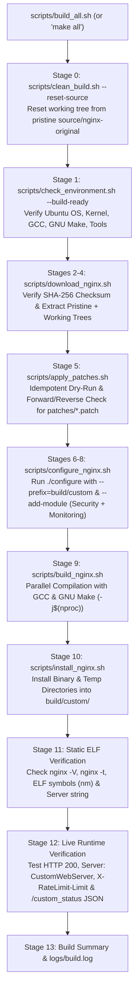

# AUTOMATED BUILD PIPELINE DOCUMENTATION
## Phase: PROMPT 6 – GCC, GNU Make & Build Automation

---

## 1. Build System Architecture

The Custom Nginx Build System automates the complete lifecycle from source verification and idempotent C patching to module integration, parallel GCC compilation, isolated installation, and post-build ELF/runtime verification.



---

## 2. Build Scripts Inventory (`scripts/`)

All scripts enforce strict error handling (`set -euo pipefail`), log output to `logs/build.log`, and require zero `sudo` privileges:

| Script | Responsibility |
| :--- | :--- |
| [scripts/download_nginx.sh](file:///home/truongphuoc/Desktop/custom-nginx-project/scripts/download_nginx.sh) | Downloads `nginx-1.26.2.tar.gz`, verifies its cryptographic SHA-256 hash (`627fe086209bba80a2853a0add9d958d7ebbdffa1a8467a5784c9a6b4f03d738`), preserves an untouched reference tree in `source/nginx-original/`, and extracts the working tree into `source/nginx/`. |
| [scripts/apply_patches.sh](file:///home/truongphuoc/Desktop/custom-nginx-project/scripts/apply_patches.sh) | Iterates through `patches/*.patch`, performs a forward `--dry-run -N` check before applying, and detects already-applied patches via reverse `--dry-run -R` so patches are never duplicated. |
| [scripts/configure_nginx.sh](file:///home/truongphuoc/Desktop/custom-nginx-project/scripts/configure_nginx.sh) | Invokes `bash ./configure` with `--with-cc=gcc`, isolated `--prefix=/home/truongphuoc/Desktop/custom-nginx-project/build/custom`, `--add-module=.../modules/security`, and `--add-module=.../modules/monitoring`, then verifies `objs/ngx_modules.c`. |
| [scripts/build_nginx.sh](file:///home/truongphuoc/Desktop/custom-nginx-project/scripts/build_nginx.sh) | Compiles the configured source tree using `make -C source/nginx -j$(nproc)` and verifies that `objs/nginx` is produced. |
| [scripts/install_nginx.sh](file:///home/truongphuoc/Desktop/custom-nginx-project/scripts/install_nginx.sh) | Runs `make install` into `build/custom/` and creates the isolated `client_body_temp`, `proxy_temp`, `fastcgi_temp`, `uwsgi_temp`, and `scgi_temp` directories. |
| [scripts/clean_build.sh](file:///home/truongphuoc/Desktop/custom-nginx-project/scripts/clean_build.sh) | Gracefully stops any running Custom Nginx instance, runs `make clean`, removes temporary artifacts, and supports `--reset-source` to restore `source/nginx/` from `source/nginx-original/`. |
| [scripts/build_all.sh](file:///home/truongphuoc/Desktop/custom-nginx-project/scripts/build_all.sh) | Master orchestrator executing all 13 stages end-to-end and generating the final build report. |

---

## 3. Top-Level GNU Makefile Targets (`Makefile`)

File location: [Makefile](file:///home/truongphuoc/Desktop/custom-nginx-project/Makefile)

- `make` / `make all`: Runs `scripts/build_all.sh` (full 13-stage clean rebuild & verification).
- `make check`: Runs `scripts/check_environment.sh --build-ready`.
- `make download`: Runs `scripts/download_nginx.sh`.
- `make patch`: Runs `scripts/apply_patches.sh`.
- `make configure`: Applies patches and runs `scripts/configure_nginx.sh`.
- `make build`: Runs `scripts/build_nginx.sh`.
- `make install`: Runs `scripts/install_nginx.sh`.
- `make run`: Starts `build/custom/sbin/nginx` on port `8080`.
- `make stop`: Gracefully stops `build/custom/sbin/nginx`.
- `make test`: Validates `nginx -t` and runs both `tests/test_security.sh` and `tests/test_monitoring.sh`.
- `make clean`: Runs `scripts/clean_build.sh`.

---

## 4. Verification Output (`./scripts/build_all.sh`)

```text
======================================================================
                    CUSTOM NGINX BUILD SUMMARY                        
======================================================================
  * Build Status       : SUCCESS (Exit Code 0)
  * Nginx Base Version : 1.26.2
  * Compiler & Make    : gcc (Ubuntu 9.4.0-1ubuntu1~20.04.2) 9.4.0 / GNU Make 4.2.1
  * Installed Binary   : /home/truongphuoc/Desktop/custom-nginx-project/build/custom/sbin/nginx
  * Binary Size        : 5272040 bytes
  * Binary SHA-256     : 3ef689ed3515411b4869c4d7349c7e07ad68474381b5e848a5f12635ad22d33d
  * Patches Applied    : custom_server_header.patch
  * Custom Modules     : ngx_http_custom_security_module, ngx_http_custom_monitoring_module
  * Build Duration     : 15 seconds
  * Full Build Log     : /home/truongphuoc/Desktop/custom-nginx-project/logs/build.log
======================================================================
```
