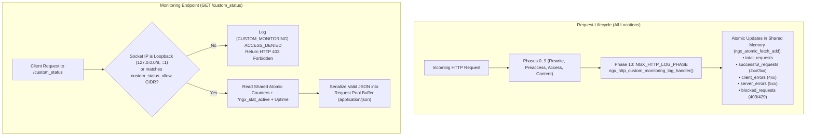

# CUSTOM MONITORING MODULE DOCUMENTATION
## Module: `ngx_http_custom_monitoring_module`

---

## 1. Architecture Overview

`ngx_http_custom_monitoring_module` is a custom C HTTP module engineered using the Nginx HTTP Module API (`NGX_HTTP_MODULE`). It combines two distinct mechanisms inside Nginx's event-driven architecture:
1. **Global Log-Phase Collector (`NGX_HTTP_LOG_PHASE`)**: Executes `ngx_http_custom_monitoring_log_handler()` at the conclusion of every HTTP request across all server/location blocks, updating lock-free atomic counters in a shared memory zone (`custom_monitoring_shm_zone`).
2. **Access-Controlled JSON Content Handler (`/custom_status`)**: Attaches `ngx_http_custom_monitoring_status_handler()` to locations configured with `custom_status on;`, verifying the client's socket IP against localhost and configured admin CIDRs before serializing live runtime counters into JSON.



### Key Source Files
- **Module C Source**: [modules/monitoring/ngx_http_custom_monitoring_module.c](file:///home/truongphuoc/Desktop/custom-nginx-project/modules/monitoring/ngx_http_custom_monitoring_module.c)
- **Addon Build Script**: [modules/monitoring/config](file:///home/truongphuoc/Desktop/custom-nginx-project/modules/monitoring/config)
- **Automated Test Suite**: [tests/test_monitoring.sh](file:///home/truongphuoc/Desktop/custom-nginx-project/tests/test_monitoring.sh)

---

## 2. Runtime Telemetry Metrics & Data Sources

All metrics reported by `/custom_status` are retrieved in real time from shared memory and Nginx kernel/event state (zero hardcoded values):

| JSON Field | C Source / Calculation | Description |
| :--- | :--- | :--- |
| `server` | `"CustomWebServer"` | Matches the customized Server identity from Prompt 3. |
| `status` | `"running"` | Indicates active worker event loop processing the request. |
| `total_requests` | `mcf->sh->total_requests + 1` | Total external requests processed across all workers (including current request). |
| `successful_requests` | `mcf->sh->successful_requests + 1` | Requests completed with HTTP `2xx` or `3xx` status codes. |
| `client_errors` | `mcf->sh->client_errors` | Requests resulting in HTTP `4xx` status codes (`400`, `403`, `404`, `429`, etc.). |
| `server_errors` | `mcf->sh->server_errors` | Requests resulting in HTTP `5xx` status codes (`500`, `502`, `503`, `504`). |
| `blocked_requests` | `mcf->sh->blocked_requests` | Subset of requests blocked by security or access rules (`HTTP 429` or `HTTP 403`). |
| `active_connections` | `*ngx_stat_active` | Real-time active TCP connections tracked by the Nginx event core (`ngx_event.c`). |
| `uptime_seconds` | `ngx_time() - mcf->sh->start_time` | Elapsed seconds since the shared memory zone was initialized by the Master process. |

---

## 3. Shared Memory & Lock-Free Atomic Operations

### 3.1. Shared Memory Structure (`ngx_http_custom_monitoring_shctx_t`)
Allocated in a **256 KB** shared memory zone (`custom_monitoring_shm_zone`) via `ngx_shared_memory_add()`:
```c
typedef struct {
    time_t          start_time;          /* Master/Cycle start epoch (ngx_time()) */
    ngx_atomic_t    total_requests;      /* Total HTTP requests processed */
    ngx_atomic_t    successful_requests; /* HTTP 2xx, 3xx responses */
    ngx_atomic_t    client_errors;       /* HTTP 4xx responses */
    ngx_atomic_t    server_errors;       /* HTTP 5xx responses */
    ngx_atomic_t    blocked_requests;    /* Security-blocked requests (HTTP 403 & 429) */
} ngx_http_custom_monitoring_shctx_t;
```

### 3.2. Zero Lock Contention
Unlike complex tree structures that require spinlocks, scalar counters in `ngx_http_custom_monitoring_shctx_t` use CPU-level atomic fetch-and-add instructions (`ngx_atomic_fetch_add`, which compiles to `lock xadd` on `x86_64`). This guarantees:
- **Zero race conditions** across multiple Worker processes.
- **Zero mutex lock contention** on the hot request path (`NGX_HTTP_LOG_PHASE`).
- **Zero memory leaks**: JSON output buffers are allocated from the per-request pool (`ngx_create_temp_buf(r->pool, 512)`) and automatically reclaimed when the request finishes.

---

## 4. Access Control Design

To prevent public exposure of server internals, `ngx_http_custom_monitoring_check_access()` inspects the underlying socket address (`r->connection->sockaddr`) before generating the JSON payload:
1. **Loopback Whitelist (Default Enabled)**:
   - IPv4 `127.0.0.0/8` (`(ntohl(sin_addr) >> 24) == 127`)
   - IPv6 `::1` (`IN6_IS_ADDR_LOOPBACK`)
   - IPv4-mapped IPv6 `::ffff:127.0.0.1` (`IN6_IS_ADDR_V4MAPPED`)
2. **Configurable Admin IP / CIDR Whitelist (`custom_status_allow`)**:
   - Parses administrator IPv4/IPv6 addresses or CIDR blocks using Nginx's native `ngx_ptocidr()` function and stores them in `lcf->allowed_cidrs`.
   - Unauthorized clients receive `HTTP 403 Forbidden` and trigger a `[CUSTOM_MONITORING] ACCESS_DENIED` warning in `logs/error.log`.

### Configuration Directives

| Directive | Context | Default | Description |
| :--- | :--- | :--- | :--- |
| `custom_status` | `server`, `location` | `off` | Enables the JSON monitoring handler in the location. |
| `custom_status_allow` | `http`, `server`, `location` | — | Whitelists an admin IP or CIDR subnet (e.g., `10.10.0.1` or `192.168.100.0/24`). |
| `custom_status_localhost` | `http`, `server`, `location` | `on` | Controls whether loopback (`127.0.0.1` / `::1`) is automatically permitted. |

---

## 5. Test Results (`tests/test_monitoring.sh`)

Executed `./tests/test_monitoring.sh` against `build/custom/sbin/nginx`:

1. **JSON Format & Schema Validation**: `[PASS]` Validated via `python3 -m json.tool` with `Content-Type: application/json`.
2. **Runtime Counter Accuracy**: `[PASS]` After sending 5 valid requests (`200 OK`) and 3 missing page requests (`404 Not Found`), `total_requests`, `successful_requests`, and `client_errors` incremented by exact counts.
3. **Blocked Requests Integration**: `[PASS]` Triggering 30 rapid requests (`20` allowed, `10` rate-limited with `HTTP 429`) incremented `blocked_requests` by `10` and `client_errors` by `10`.
4. **Access Control Enforcement**: `[PASS]` `127.0.0.1` and `[::1]` received `HTTP 200`, while unauthorized access to `/custom_status_admin_only` was rejected with `HTTP 403 Forbidden` and logged in `logs/error.log`.
5. **Multi-Worker Stability**: `[PASS]` Concurrent polling across 2 Worker processes produced consistent JSON output with zero worker crashes:
   ```json
   {
     "server": "CustomWebServer",
     "status": "running",
     "total_requests": 66,
     "successful_requests": 52,
     "client_errors": 14,
     "server_errors": 0,
     "blocked_requests": 11,
     "active_connections": 1,
     "uptime_seconds": 4
   }
   ```
