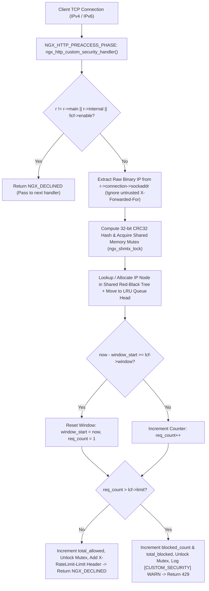

# CUSTOM SECURITY MODULE DOCUMENTATION
## Module: `ngx_http_custom_security_module`

---

## 1. Architecture Overview

`ngx_http_custom_security_module` is a custom C HTTP security module written directly against the Nginx HTTP Module API (`NGX_HTTP_MODULE`). It operates in the `NGX_HTTP_PREACCESS_PHASE` of the 11-stage HTTP request pipeline, inspecting every incoming external client request before content generation occurs.



### Key Source Files
- **Module C Source**: [modules/security/ngx_http_custom_security_module.c](file:///home/truongphuoc/Desktop/custom-nginx-project/modules/security/ngx_http_custom_security_module.c)
- **Addon Build Script**: [modules/security/config](file:///home/truongphuoc/Desktop/custom-nginx-project/modules/security/config)
- **Automated Test Suite**: [tests/test_security.sh](file:///home/truongphuoc/Desktop/custom-nginx-project/tests/test_security.sh)

---

## 2. Rate-Limiting Algorithm & IP Extraction

### 2.1. Binary Socket IP Extraction (`ngx_http_custom_security_extract_ip_key`)
- Instead of parsing strings or trusting HTTP headers like `X-Forwarded-For` (which an attacker can trivially spoof unless rewritten beforehand by a trusted proxy module), the module inspects `r->connection->sockaddr->sa_family`:
  - **`AF_INET` (IPv4)**: Extracts the 4-byte binary `struct in_addr` (`sin->sin_addr`).
  - **`AF_INET6` (IPv6)**: Extracts the 16-byte binary `struct in6_addr` (`sin6->sin6_addr.s6_addr`).
- Computes a fast 32-bit hash via `ngx_crc32_short(ip_key.data, ip_key.len)` for `O(log N)` Red-Black Tree indexing, with full binary `ngx_memn2cmp()` comparison to prevent hash collisions.

### 2.2. Per-IP Time-Window Counter Algorithm
For each client IP node (`ngx_http_custom_security_node_t`):
1. Retrieve current Nginx event loop millisecond timestamp (`now = ngx_current_msec`).
2. Calculate `elapsed = now - node->window_start`.
3. If `elapsed >= lcf->window` (or clock skew `elapsed < 0`), reset the window:
   - `node->window_start = now`
   - `node->req_count = 1`
4. Otherwise (`elapsed < lcf->window`), increment `node->req_count++`.
5. If `node->req_count > lcf->limit`:
   - Increment per-IP `node->blocked_count` and global atomic `mcf->sh->total_blocked`.
   - Write a structured security warning `[CUSTOM_SECURITY] RATE_LIMIT_EXCEEDED` to `error.log`.
   - Return `NGX_HTTP_TOO_MANY_REQUESTS` (`HTTP 429`).

### 2.3. Subrequest & Internal Redirect Protection
When a client requests a directory URI like `GET /`, `ngx_http_index_module` performs an internal redirect to `/index.html`, which re-runs `NGX_HTTP_PREACCESS_PHASE` with `r->internal = 1`.
By checking `if (r != r->main || r->internal) return NGX_DECLINED;`, the module guarantees that each external HTTP request is counted **exactly once**.

---

## 3. Shared Memory & Multi-Worker Synchronization

### 3.1. Shared Memory Zone (`custom_security_shm_zone`)
- Registered via `ngx_shared_memory_add()` during `init_main_conf` with a default size of **2 MB** (configurable via `custom_security_shm_size`).
- Managed by Nginx's slab allocator (`ngx_slab_pool_t`), mapped via `mmap(MAP_ANON | MAP_SHARED)` in the Master process and inherited by all Worker processes.
- Stores `ngx_http_custom_security_shctx_t`:
  - `ngx_rbtree_t rbtree`: Red-Black Tree of active IP nodes (`O(log N)` lookup, insertion, deletion).
  - `ngx_queue_t lru_queue`: Doubly-linked LRU queue ordered from most-recently seen (head) to least-recently seen (tail).
  - Global atomic counters: `total_checked`, `total_allowed`, `total_blocked`, `active_nodes`.

### 3.2. Locking & Race-Condition Prevention
- Every Red-Black Tree and LRU Queue operation is protected by the shared slab pool mutex:
  ```c
  ngx_shmtx_lock(&mcf->shpool->mutex);
  /* Critical section: lookup/insert node, update window & counters */
  ngx_shmtx_unlock(&mcf->shpool->mutex);
  ```
- Global telemetry counters use atomic instructions (`ngx_atomic_fetch_add`), preventing torn reads or lost updates across multiple CPU cores.

### 3.3. Memory Control & Exhaustion Handling
- **Opportunistic LRU Sweeping**: Before every new slab allocation, `ngx_http_custom_security_expire(mcf, 0, now, window)` inspects the tail of `lru_queue` and frees up to 3 expired IP nodes.
- **Forced Eviction on OOM**: If `ngx_slab_alloc_locked()` returns `NULL` (shared memory full under a massive DDoS of unique IPs), the module calls `ngx_http_custom_security_expire(mcf, 1, now, window)` to forcefully evict the oldest LRU entry and retries the allocation.
- **Graceful Fail-Open**: If allocation still fails, the worker unlocks the mutex, logs an `[CUSTOM_SECURITY] ALERT` message, and returns `NGX_DECLINED` without crashing or leaking memory.

---

## 4. Configuration Directives

| Directive | Context | Default | Description |
| :--- | :--- | :--- | :--- |
| `custom_security` | `http`, `server`, `location` | `off` | Enables or disables custom rate-limiting security in the context. |
| `custom_security_limit` | `http`, `server`, `location` | `20` | Maximum allowed requests per client IP within the time window. |
| `custom_security_window` | `http`, `server`, `location` | `1s` (`1000ms`) | Time window duration (supports Nginx time units: `ms`, `s`, `m`). |
| `custom_security_shm_size` | `http` | `2m` | Size of the shared memory zone storing per-IP states. |

### Example Configuration (`config/nginx.conf`)
```nginx
http {
    custom_security_shm_size 2m;

    server {
        listen 8080;
        listen [::]:8080;

        location / {
            custom_security on;
            custom_security_limit 20;
            custom_security_window 1s;

            root /home/truongphuoc/Desktop/custom-nginx-project/web;
            index index.html;
        }
    }
}
```

---

## 5. Verification & Test Results (`tests/test_security.sh`)

Executed `./tests/test_security.sh` against `build/custom/sbin/nginx` running 2 Worker Processes:

1. **Multi-Worker Verification**: `[PASS]` Master PID `21204` with 2 active Worker processes (`21206`, `21207`).
2. **Normal Request & Header Check**: `[PASS]` Returned `HTTP/1.1 200 OK`, `Server: CustomWebServer`, `X-RateLimit-Limit: 20`.
3. **Below Threshold Test (15 req/s <= 20)**: `[PASS]` `15/15` requests returned `HTTP 200`.
4. **Burst Exceeding Threshold (35 req/s > 20)**: `[PASS]` Exactly `20` requests returned `HTTP 200` and `15` requests returned `HTTP 429 Too Many Requests`.
5. **IPv4/IPv6 & `X-Forwarded-For` Spoofing Resistance**: `[PASS]` Spoofed `X-Forwarded-For: 203.0.113.99` from rate-limited `127.0.0.1` was blocked (`HTTP 429`), while an independent IPv6 client `[::1]` was allowed (`HTTP 200`).
6. **Window Recovery**: `[PASS]` After waiting `1.2s`, client `127.0.0.1` automatically recovered and received `HTTP 200`.
7. **Security Event Logging (`logs/error.log`)**: `[PASS]` Recorded structured warning logs:
   ```text
   2026/11/15 02:44:34 [warn] 21207#0: *37 [CUSTOM_SECURITY] RATE_LIMIT_EXCEEDED: client=127.0.0.1 method="GET" uri="/" count=21 limit=20 window=1000ms total_ip_blocks=1 worker_pid=21207, client: 127.0.0.1, server: localhost, request: "GET / HTTP/1.1", host: "127.0.0.1:8080"
   ```

---

## 6. Known Limitations

1. **Fixed Window Boundary**: Uses a per-IP fixed window reset (`now - window_start >= window`), which is fast and memory-efficient (`O(1)` arithmetic per request) but can allow a short double-burst right across a window boundary compared to a leaky-bucket delay queue.
2. **Global Shared Zone**: All locations share one shared memory Red-Black Tree keyed by client IP address. If multiple locations enable `custom_security`, requests from the same client IP across those locations share the per-IP counter.
