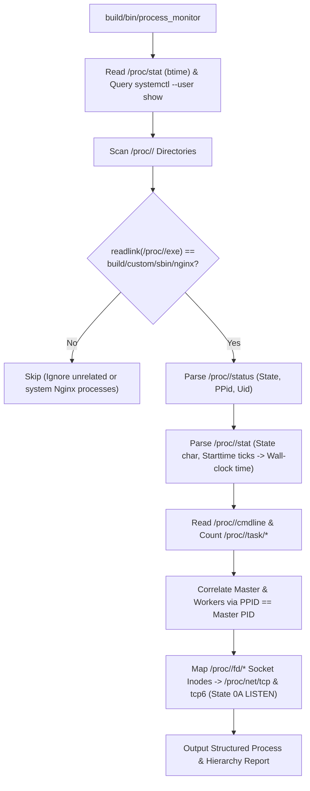

# LINUX PROCESS MONITORING DOCUMENTATION
## Tool: Custom Nginx Process Monitor (`src/process_monitor.c`)

---

## 1. Overview & Architecture

The **Custom Nginx Process Monitor** ([src/process_monitor.c](file:///home/truongphuoc/Desktop/custom-nginx-project/src/process_monitor.c) & [include/process_monitor.h](file:///home/truongphuoc/Desktop/custom-nginx-project/include/process_monitor.h)) is a native Linux C systems utility that inspects the kernel's `/proc` pseudo-filesystem (`procfs`) and `systemd` state to identify, verify, and report the live process hierarchy of our Custom Nginx Web Server.



---

## 2. Linux Process Concepts & `procfs` Interfaces

### 2.1. Linux Processes, PID & PPID
- **PID (Process ID)**: Unique positive integer assigned by the Linux kernel (`task_struct->tgid`) to each running process.
- **PPID (Parent Process ID)**: The PID of the parent process that created the child via `fork()` / `clone()`.
- **Master / Worker Relationship in Nginx**:
  - When `systemd` starts Custom Nginx, the **Master Process** (`nginx: master process ...`) has `PPID` pointing to the `systemd` manager (PID `2212`).
  - The Master calls `fork()` (`ngx_spawn_process` in `src/os/unix/ngx_process.c`) to spawn **Worker Processes** (`nginx: worker process`). Every Worker has `PPID == Master PID`.
  - If a Worker process terminates unexpectedly (`SIGKILL` / `SIGSEGV`), the Linux kernel delivers `SIGCHLD` to the Master process, which reaps the exit status via `waitpid()` (preventing zombies) and immediately spawns a replacement Worker.

### 2.2. Exact `procfs` Files Parsed by `src/process_monitor.c`

| `procfs` Path | How `src/process_monitor.c` Uses It |
| :--- | :--- |
| `/proc/<PID>/exe` | Resolved via `readlink()`. Strictly compared against `/home/truongphuoc/Desktop/custom-nginx-project/build/custom/sbin/nginx` so the monitor **never** confuses system `/usr/sbin/nginx` or other binaries with Custom Nginx. |
| `/proc/<PID>/status` | Parsed for human-readable `State:` (e.g., `S (sleeping)`), `PPid:`, and `Uid:`. |
| `/proc/<PID>/stat` | Parsed after the closing `)` of `comm` to extract Field 3 (`state` character: `R`, `S`, `D`, `Z`, `T`), Field 4 (`ppid`), and Field 22 (`starttime` in clock ticks since boot). Combined with `btime` from `/proc/stat` and `sysconf(_SC_CLK_TCK)` to calculate the exact `YYYY-MM-DD HH:MM:SS` start time. |
| `/proc/<PID>/cmdline` | Raw NUL-delimited argument vector modified by Nginx's `ngx_setproctitle()`. Decoded to distinguish `nginx: master process ...` from `nginx: worker process`. |
| `/proc/<PID>/task/` | Enumerated with `opendir()` / `readdir()` to count kernel threads belonging to the process. |
| `/proc/<PID>/fd/` + `/proc/net/tcp[6]` | Reads `socket:[inode]` symlinks in `/proc/<MasterPID>/fd/` and matches those socket inodes against rows in `/proc/net/tcp` and `/proc/net/tcp6` where state is `0A` (`TCP_LISTEN`), extracting the hexadecimal port (`0x1F90` = `8080`). |

### 2.3. Linux Process States (`State`)
- **`R` (Running / Runnable)**: Executing on a CPU core or queued in the kernel runqueue.
- **`S` (Interruptible Sleep)**: Blocked waiting for an event or I/O completion (e.g., Master waiting in `sigsuspend()`, Workers waiting in `epoll_wait()`).
- **`D` (Uninterruptible Disk Sleep)**: Waiting on synchronous block/hardware I/O.
- **`Z` (Zombie / Defunct)**: Terminated process whose exit status has not yet been reaped via `waitpid()` by its parent.
- **`T` (Stopped / Traced)**: Paused by `SIGSTOP` or `ptrace`.

---

## 3. Compilation & Usage

### Compile Command
```bash
mkdir -p build/bin
gcc -Wall -Wextra -Werror -O2 -Iinclude src/process_monitor.c -o build/bin/process_monitor
```

### Runtime Output (Active Service)
```text
======================================================================
CUSTOM NGINX PROCESS MONITOR
======================================================================
Target Binary      : /home/truongphuoc/Desktop/custom-nginx-project/build/custom/sbin/nginx
Installation Root  : /home/truongphuoc/Desktop/custom-nginx-project

Master PID: 36449
Worker PID: 36450
Worker PID: 36451

Workers: 2
Service: ACTIVE
Process State: RUNNING (S (sleeping))
Port: 8080

----------------------------------------------------------------------
PROCESS HIERARCHY & PROCFS TELEMETRY
----------------------------------------------------------------------
[MASTER] PID=36449 | PPID=2212 | State=S (S (sleeping)) | Threads=1 | Started=2026-11-15 03:03:03
  ├─ Exe     : /home/truongphuoc/Desktop/custom-nginx-project/build/custom/sbin/nginx
  ├─ Cmdline : nginx: master process /home/truongphuoc/Desktop/custom-nginx-project/build/custom/sbin/nginx -p /home/truongphuoc/Desktop/custom-nginx-project -c /home/truongphuoc/Desktop/custom-nginx-project/config/nginx.conf
  ├─ [WORKER 1] PID=36450 | PPID=36449 (Master) | State=S (S (sleeping)) | Threads=1 | Started=2026-11-15 03:03:03
       Cmdline : nginx: worker process
  └─ [WORKER 2] PID=36451 | PPID=36449 (Master) | State=S (S (sleeping)) | Threads=1 | Started=2026-11-15 03:03:03
       Cmdline : nginx: worker process
======================================================================
```

---

## 4. Automated Test Results (`tests/test_process_monitor.sh`)

Executed `./tests/test_process_monitor.sh` (**5 PASSED, 0 FAILED**):
1. **GCC Compilation**: `[PASS]` Clean build with `-Wall -Wextra -Werror`.
2. **Running State Detection**: `[PASS]` Matched exact Master PID (`logs/nginx.pid`), 2 Worker PIDs, `Service: ACTIVE`, and `Port: 8080`.
3. **Worker Termination & Auto-Respawn**: `[PASS]` Killed Worker `36450` (`kill -9`), verified Master automatically spawned replacement Worker `36892`, and confirmed Process Monitor immediately reflected the new Worker PID.
4. **Stopped State Detection**: `[PASS]` After stopping `custom-nginx.service`, reported `Master PID: NONE`, `Workers: 0`, `Service: INACTIVE`, `Process State: STOPPED`.
5. **Service Restart & Recovery**: `[PASS]` Restarted service and verified `ACTIVE` state with 2 Workers.
