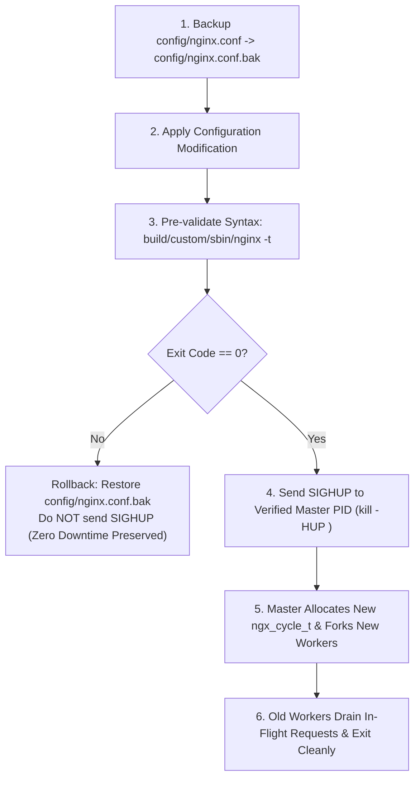

# LINUX SIGNAL HANDLING & GRACEFUL SHUTDOWN IN NGINX
## Phase: PROMPT 9 – Signal Handling & Graceful Shutdown

---

## 1. Signal Architecture in Nginx C Source

In Nginx ([source/nginx/src/os/unix/ngx_process.c](file:///home/truongphuoc/Desktop/custom-nginx-project/source/nginx/src/os/unix/ngx_process.c#L39-L83) and [source/nginx/src/os/unix/ngx_process_cycle.c](file:///home/truongphuoc/Desktop/custom-nginx-project/source/nginx/src/os/unix/ngx_process_cycle.c#L139-L275)), POSIX signals are registered via `sigaction()` using the `signals[]` dispatch table.

To guarantee async-signal safety, `ngx_signal_handler()` **never** executes complex logic inside the signal interrupt context. Instead, it sets volatile `sig_atomic_t` flags (`ngx_reconfigure`, `ngx_quit`, `ngx_terminate`, `ngx_reopen`, `ngx_change_binary`, `ngx_reap`) and wakes the Master Process out of `sigsuspend(&set)`. The Master Process then coordinates Worker Processes using UNIX domain `socketpair()` control channels (`NGX_CMD_QUIT`, `NGX_CMD_TERMINATE`, `NGX_CMD_REOPEN`) or POSIX signals.

---

## 2. Detailed Analysis of POSIX Signals

| Signal | Number (`x86_64`) | Nginx Internal Macro | `nginx -s` Equivalent | Master Process Behavior | Worker Process Behavior |
| :--- | :---: | :--- | :--- | :--- | :--- |
| **`SIGHUP`** | `1` | `NGX_RECONFIGURE_SIGNAL` | `nginx -s reload` | Sets `ngx_reconfigure = 1`. Calls `ngx_init_cycle(old_cycle)` to parse `nginx.conf`. If valid, spawns new Workers with the new configuration and sends `NGX_CMD_QUIT` (`SIGQUIT`) to old Workers. If invalid, keeps running on the old cycle. | Old Workers stop accepting new connections, finish active HTTP requests, close sockets, and exit (`0`). New Workers immediately accept new connections. |
| **`SIGINT`** | `2` | `SIGINT` | — | Sets `ngx_terminate = 1`. Sends `SIGTERM` to all Workers. If Workers do not exit within a backoff timer (`delay > 1000ms`), escalates to `SIGKILL`. | Immediately closes all open sockets, aborts event loop, and exits (`0`). |
| **`SIGQUIT`** | `3` | `NGX_SHUTDOWN_SIGNAL` | `nginx -s quit` | **Graceful Shutdown**: Sets `ngx_quit = 1`. Closes listening sockets and sends `NGX_CMD_QUIT` (`SIGQUIT`) to all Workers. Waits for all Workers to reap (`!live`) before removing `nginx.pid` and exiting. | Sets `ngx_exiting = 1`, closes listening sockets, cancels idle keepalive timers, finishes all in-flight HTTP requests, and exits cleanly (`0`). |
| **`SIGTERM`** | `15` | `NGX_TERMINATE_SIGNAL` | `nginx -s stop` | **Fast Shutdown**: Sets `ngx_terminate = 1`. Sends `NGX_CMD_TERMINATE` (`SIGTERM`) to all Workers, reaps children on `SIGCHLD`, deletes `nginx.pid`, and exits. | Immediately closes active connections without waiting for slow clients and exits. |
| **`SIGUSR1`** | `10` | `NGX_REOPEN_SIGNAL` | `nginx -s reopen` | **Reopen Logs**: Sets `ngx_reopen = 1`. Calls `ngx_reopen_files(cycle)` to reopen `access.log` and `error.log` file descriptors and notifies all Workers. | Reopens log files (`open(..., O_CREAT|O_WRONLY|O_APPEND)`) and closes old file descriptors, enabling zero-downtime `logrotate`. |
| **`SIGUSR2`** | `12` | `NGX_CHANGEBIN_SIGNAL` | — | **Live Binary Upgrade**: Sets `ngx_change_binary = 1`. Renames `logs/nginx.pid` to `logs/nginx.pid.oldbin`, exports listening socket file descriptor numbers in the `NGINX=` environment variable, and `execve()`s a new Master Process binary. | Existing Workers continue serving traffic under the old Master until the administrator sends `SIGWINCH` or `SIGQUIT` to the old Master PID. |

---

## 3. Safe Graceful Reload & Rollback Workflow

---

## 4. Test Suite & Empirical Results (`scripts/test_signal_handling.sh`)

File location: [scripts/test_signal_handling.sh](file:///home/truongphuoc/Desktop/custom-nginx-project/scripts/test_signal_handling.sh)

Executed `./scripts/test_signal_handling.sh` against Custom Nginx (**7 PASSED, 0 FAILED**):

1. **`SIGHUP` Graceful Reload (Valid Config Change)**: `[PASS]`
   - Modified `worker_processes` from `2` to `3`, verified `nginx -t`, sent `SIGHUP` to Master PID `37317`.
   - Master PID remained `37317`; old Workers (`37318`, `37319`) exited gracefully (`code 0`) and 3 new Workers (`37432`, `37433`, `37434`) took over seamlessly.
2. **Invalid Configuration Rollback Protection**: `[PASS]`
   - Injected invalid directive `invalid_directive_xyz 123;`.
   - Pre-reload check `nginx -t` detected the error before any signal was sent; script automatically rolled back `config/nginx.conf`, leaving active Workers (`37454`, `37455`) 100% uninterrupted (`HTTP 200`).
3. **`SIGUSR1` Zero-Downtime Log Reopening**: `[PASS]`
   - Moved `logs/access.log` to `logs/access.log.rotated` and sent `SIGUSR1` to Master PID `37317`.
   - Master logged `reopening logs` in `logs/error.log`, recreated `logs/access.log`, and recorded subsequent HTTP requests without dropping a single connection.
4. **`SIGUSR2` Live Binary Upgrade Handover**: `[PASS]`
   - Sent `SIGUSR2` to Master PID `37317`.
   - Verified `logs/nginx.pid.oldbin` held `37317` while `logs/nginx.pid` held the newly spawned Master PID `37496`. Sent `SIGQUIT` to `37317` to complete the zero-downtime handover to Master `37496`.
5. **`SIGQUIT` Graceful Shutdown with Concurrent Traffic**: `[PASS]`
   - Fired 15 concurrent HTTP requests while sending `SIGQUIT` to Master PID `37528`.
   - Master logged `gracefully shutting down`, Workers finished in-flight requests, and all processes exited cleanly with `code 0`.
6. **`SIGTERM` Fast Shutdown & Port Release**: `[PASS]`
   - Sent `SIGTERM` to Master PID `37564`, confirmed immediate termination, removal of `logs/nginx.pid`, and complete release of port `8080`.
7. **`systemd` Service Restoration**: `[PASS]`
   - Restarted `custom-nginx.service` (MainPID `37604`) and verified `/custom_status` returned `"status": "running"`.
